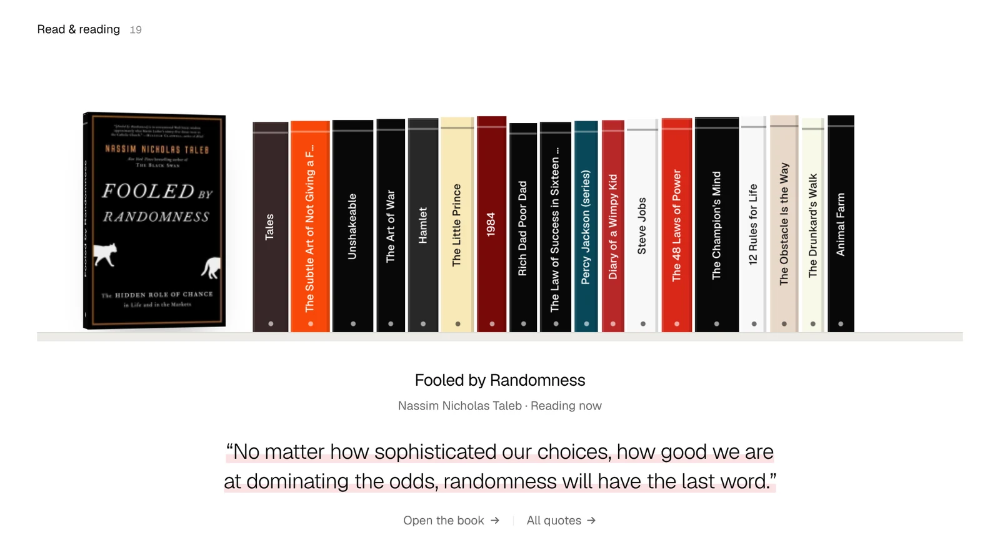
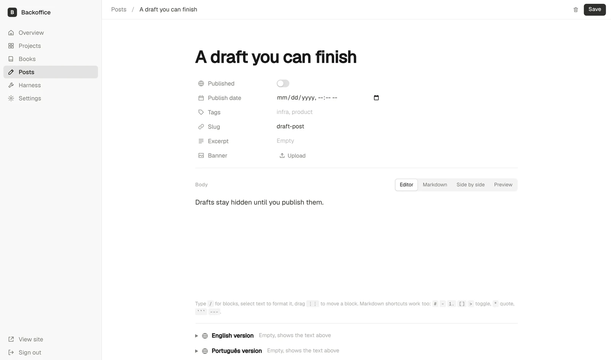

<div align="center">

# Portfolio

The source of [rickmff.com](https://rickmff.com), the personal site of Henrique Matos.<br>
Projects, books and writing, with a small backoffice to manage it all.

[](https://nextjs.org)
[](https://react.dev)
[](https://tailwindcss.com)
[](https://turso.tech)
[](https://vercel.com)


</div>

## What's inside

<table>
  <tr>
    <td width="50%" valign="top">
      
      <b>Projects</b><br>
      A gallery of work, each with its own case study.
    </td>
    <td width="50%" valign="top">
      
      <b>Books</b><br>
      An interactive 3D bookshelf, with notes and quotes.
    </td>
  </tr>
  <tr>
    <td width="50%" valign="top">
      
      <b>Backoffice</b><br>
      A Notion-style editor for every page. Google sign-in, one account.
    </td>
    <td width="50%" valign="top">
      <b>Also</b>
      <ul>
        <li>Blog in English and Portuguese, with RSS.</li>
        <li>Content API at <code>/api/content</code> to publish from scripts.</li>
        <li>Sitemap, Open Graph images and <code>llms.txt</code>.</li>
      </ul>
    </td>
  </tr>
</table>

## Stack

Next.js 15 (App Router) · React 19 · TypeScript · Tailwind CSS 4 · Drizzle ORM on Turso (libSQL) · Tiptap · Vercel Blob, Analytics and Flags

## Run locally

Requires Node.js 20+ and pnpm 10.

```bash
pnpm install
cp .env.example .env.local
pnpm db:migrate && pnpm db:seed
pnpm dev                      # http://localhost:3000
```

Without Turso variables, the app uses a local SQLite file (`./data/portfolio.db`) and stores uploads in `./uploads`.

<details>
<summary><b>Environment variables</b></summary>

| Variable | Required | Purpose |
| --- | --- | --- |
| `SESSION_SECRET` | Yes | Signs admin sessions. `openssl rand -base64 48` |
| `SITE_URL` | Yes | Public URL for OAuth, sitemap and canonical links. |
| `GOOGLE_CLIENT_ID`, `GOOGLE_CLIENT_SECRET` | For `/admin` | Google OAuth. Redirect URI: `<SITE_URL>/admin/auth/callback` |
| `ADMIN_EMAIL` | For `/admin` | The only Google account allowed in. |
| `TURSO_DATABASE_URL`, `TURSO_AUTH_TOKEN` | Production | Turso database. Empty means local SQLite. |
| `BLOB_READ_WRITE_TOKEN` | No | Uploads to Vercel Blob instead of disk. |
| `CONTENT_API_TOKEN` | No | Enables the content API (32+ chars). |
| `GOOGLE_BOOKS_API_KEY` | No | Book previews. |
| `GITHUB_TOKEN` | No | Contribution graph on the home page. |
| `DATABASE_URL` | No | Local database file. Default `file:./data/portfolio.db` |

</details>

<details>
<summary><b>Scripts</b></summary>

| Command | Action |
| --- | --- |
| `pnpm dev` | Dev server. |
| `pnpm build` / `pnpm start` | Production build and server. |
| `pnpm lint` / `pnpm typecheck` | Lint and type-check. |
| `pnpm db:generate` | New migration from `src/db/schema.ts`. |
| `pnpm db:migrate` / `pnpm db:seed` | Apply migrations / seed content. |
| `pnpm db:studio` | Drizzle Studio. |

</details>

## Deploy

Import the repo in Vercel, add the Turso integration and a Blob store, then set the variables above. The build runs `pnpm vercel-build`: migrate, seed, then `next build`. It fails on purpose when `TURSO_DATABASE_URL` is missing.

## Structure

```
src/app/(site)   public pages: home, work, books, quotes, blog, about
src/app/admin    backoffice
src/app/api      content API
src/components   UI: 3D book, shelf, gallery, ...
src/db           Drizzle schema and connection
src/lib          data, auth, i18n, markdown, SEO
drizzle/         SQL migrations
scripts/         migrate, seed and import scripts
```
